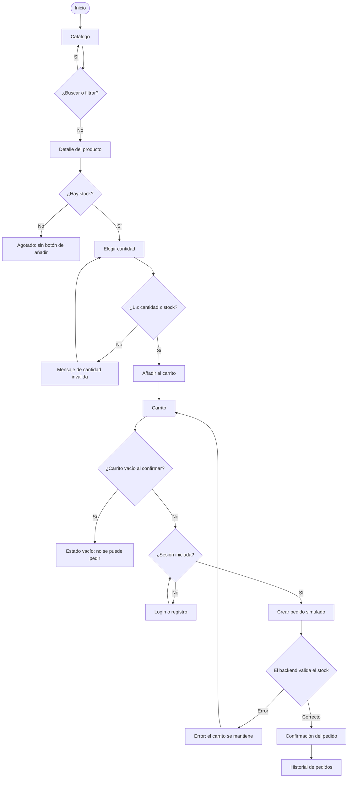

# ForgeSport — Flujo general del cliente

Recorrido del visitante desde que entra en la tienda hasta que consulta uno de sus
pedidos. No hay pagos ni envíos reales: el pedido es simulado y el catálogo usa
datos de demostración.

## Mapa del recorrido

## Etapas

| Etapa | Acción del usuario | Respuesta del sistema | Errores posibles |
| --- | --- | --- | --- |
| Inicio | Entra en la tienda y abre el catálogo | Presenta la tienda y el acceso al catálogo | Error de carga con opción de reintentar |
| Catálogo | Explora los productos, busca por nombre o filtra por categoría | Lista solo productos activos con precio, imagen y disponibilidad | Sin resultados; error de carga |
| Detalle | Abre un producto | Muestra nombre, descripción, precio, imagen, categoría y stock | Producto inexistente (404) |
| Selección | Elige la cantidad | Valida que sea al menos 1 y no supere el stock | Cantidad menor que 1 o mayor que el stock |
| Carrito | Añade, cambia cantidades, elimina o vacía | Recalcula el subtotal y valida el stock | Carrito vacío; stock insuficiente |
| Login / registro | Inicia sesión o crea una cuenta | Fusiona el carrito anónimo con el del usuario | Credenciales inválidas; email ya registrado |
| Revisión | Revisa el pedido antes de confirmar | Exige sesión iniciada y carrito no vacío | Sin sesión; carrito vacío |
| Creación | Confirma el pedido simulado | Valida el stock en backend, guarda nombre y precio del momento, reduce el stock, vacía el carrito y genera un número de pedido | Stock insuficiente; error del servidor (el carrito se conserva) |
| Confirmación | Ve el número y el resumen del pedido | Muestra el pedido con estado `pending` o `confirmed` | Ninguno |
| Historial | Consulta sus pedidos | Lista solo los pedidos del usuario autenticado | Sin pedidos (estado vacío); error de carga |

## Carrito sin login, pedido con login

- Explorar el catálogo, buscar y ver el detalle **no requiere** iniciar sesión.
- El carrito está disponible para visitantes anónimos y se guarda en cookies.
- Al iniciar sesión, el carrito anónimo se fusiona con el carrito del usuario y
  se valida el stock resultante.
- Crear un pedido **sí exige** sesión: si el usuario no está autenticado, se le
  pide login o registro y el carrito se conserva.

## Estados de error y vacío

| Situación | Qué ve el cliente |
| --- | --- |
| Catálogo sin productos activos | Estado vacío con acceso a la búsqueda |
| Búsqueda sin coincidencias | Mensaje de "sin resultados" y opción de limpiar el filtro |
| Producto agotado | Se muestra el detalle, pero sin botón de añadir |
| Cantidad inválida | Mensaje junto al selector; no se añade nada |
| Carrito vacío | Estado vacío y botón de confirmar desactivado |
| Pedido sin sesión | Redirección a login conservando el carrito |
| Error del servidor al crear el pedido | Mensaje claro y el carrito intacto para reintentar |
| Producto inexistente | Página de no encontrado con vuelta al catálogo |

## Fuera de este flujo

Pagos reales, envíos, cupones, favoritos, reseñas, recuperación de contraseña y
compra como invitado quedan fuera del MVP. El detalle está en `docs/scope.md`.
